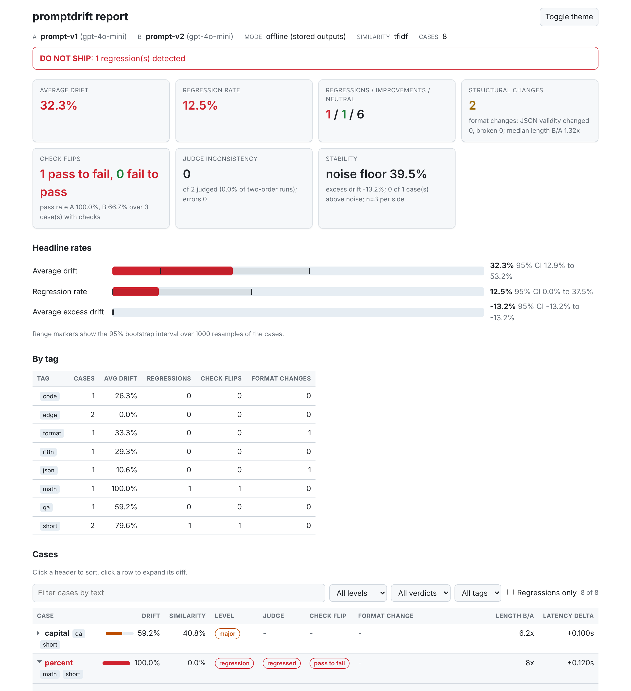
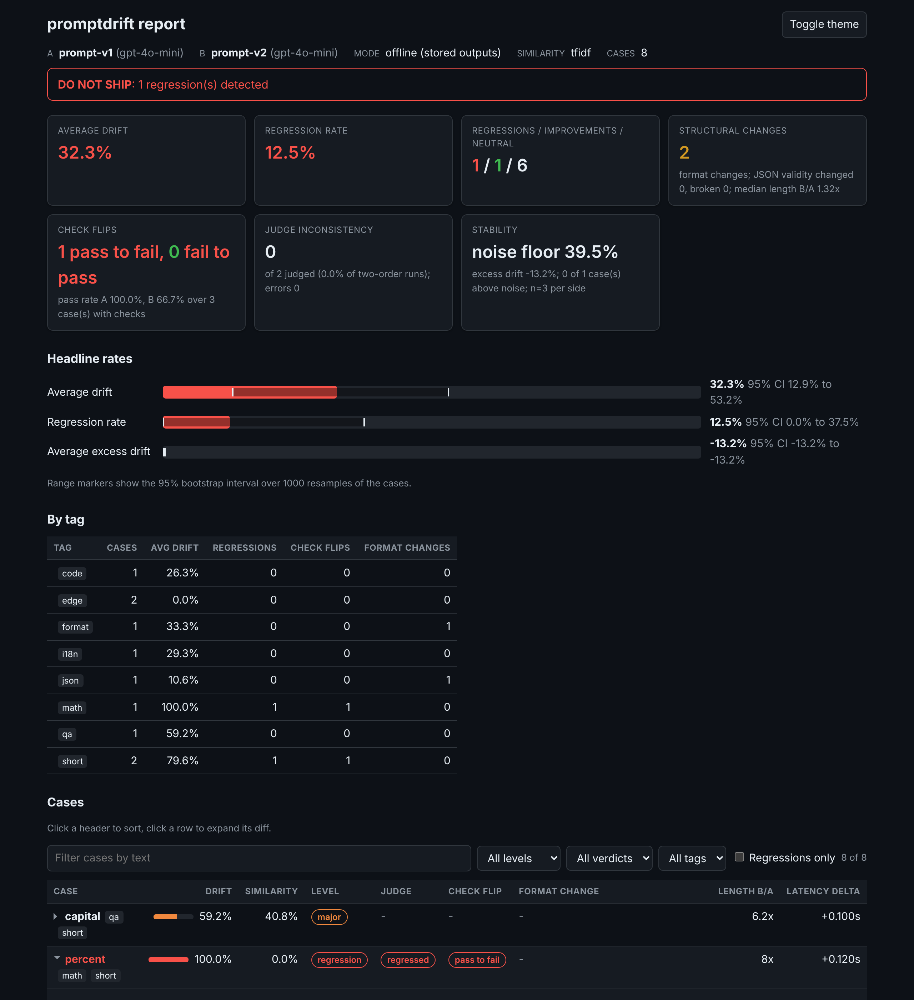
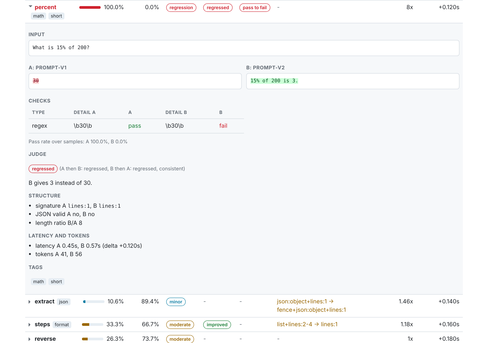

<div align="center">

# promptdrift

**Catch LLM prompt regressions in CI.**
Semantic, structural and check-based diff for prompts and model outputs, with a GitHub Action, a pytest plugin and a self-contained HTML report.

[](https://github.com/dakshtrehan/promptdrift/actions/workflows/ci.yml)
[](https://www.python.org/downloads/)
[](LICENSE)
[](https://dakshtrehan.github.io/promptdrift/)

</div>

---

You edited a system prompt. Or moved from one model to the next. Or switched providers to save money. The outputs still look fine in the three cases you eyeballed.

**How do you know the other two hundred did not quietly get worse?**

`promptdrift` compares two versions of a prompt, or two sets of logged outputs, case by case, and turns the result into something a CI job can act on: a drift score with a confidence interval, hard pass-to-fail check flips, format changes that would break a parser, a noise floor so you can tell real change from sampling noise, and an exit code.

## 30 second demo

No API key, no model call, no cost. The repository ships 16 logged cases from a support assistant, two of which regress on purpose.


<sup>Static version: [docs/assets/demo.svg](docs/assets/demo.svg). Rendered from the real output of the command shown.</sup>

```bash
git clone https://github.com/dakshtrehan/promptdrift && cd promptdrift
pip install -e .
promptdrift diff examples/offline/outputs.jsonl --name-a v1 --name-b v2 --checks examples/offline/checks.yaml --summary
```

Add `--max-regressions 0` (or `--fail-on-regression`) and the exit code is `1`, so the same command is a CI gate. Add `--html report.html` and you get the report below.

## The HTML report

One file, inline CSS and JavaScript, zero network requests: open it from a CI artifact or an air-gapped laptop.

| Light | Dark |
|---|---|
|  |  |

Click any row for the side-by-side word-level diff:



Sortable and filterable case table (free text, drift level, judge verdict, tag, regressions only), per-tag breakdown, bootstrap confidence interval bars, light and dark mode with a remembered toggle, readable with JavaScript disabled and at phone width.

## Install

> promptdrift is **not on PyPI yet**. `pip install promptdrift` does not work until the first release is published (see [RELEASE.md](RELEASE.md)). Install from GitHub for now.

```bash
pip install "git+https://github.com/dakshtrehan/promptdrift.git"
```

Or from a clone: `git clone https://github.com/dakshtrehan/promptdrift && cd promptdrift && pip install -e .`

The only required dependency is PyYAML. Extras:

| Extra | Installs | Needed for |
|---|---|---|
| `[openai]` | `openai` | live mode or the judge with OpenAI |
| `[anthropic]` | `anthropic` | live mode or the judge with Claude |
| `[all]` | both SDKs | |
| `[watch]` | `watchdog` | faster wake-ups in `promptdrift watch` (optional, polling works without it) |
| `[docs]` | mkdocs, mkdocs-material, mkdocstrings, pymdown-extensions | building the docs site (mirrors `docs/requirements.txt`) |
| `[dev]` | pytest, pytest-cov, ruff, mypy, types-PyYAML, build, twine, markdown-it-py, both SDKs | contributing |

Ollama (local models) needs `requests`, which most environments already have.

## Feature tour

### Offline diff on logged outputs

The cheapest and most common way to use promptdrift: log the outputs of the old and new prompt (from a replay, a shadow deployment or a notebook) and diff them. One JSON object per line:

```jsonl
{"case_id": "capital", "input": "What is the capital of France?", "output_a": "Paris", "output_b": "The capital of France is Paris.", "tags": ["geo"]}
{"case_id": "extract", "output_a": "{\"name\": \"Ada\"}", "output_b": "```json\n{\"name\": \"Ada\"}\n```", "checks": {"json_keys": ["name"]}}
```

| Field | Required | Meaning |
|---|---|---|
| `case_id` | yes (`id` also accepted) | Case name in the report |
| `output_a`, `output_b` | yes | A string, or a list of strings for multi-sample stability |
| `input` | no | Shown in the report and given to the judge |
| `expected` | no | Judge context, and the default value for an `exact` check |
| `checks` | no | Deterministic checks, see below |
| `tags` | no | Labels for the per-tag breakdown, the CSV column and the JUnit classname |

```bash
promptdrift diff examples/outputs.jsonl --name-a v1 --name-b v2
promptdrift diff examples/outputs.jsonl --name-a v1 --name-b v2 --json -o report.json
```

```python
import yaml

from promptdrift import compare_outputs, print_report

checks = yaml.safe_load(open("examples/offline/checks.yaml"))      # default checks, optional
report = compare_outputs("examples/offline/outputs.jsonl", version_a="v1", version_b="v2",
                         checks=checks)
print(report.avg_drift, len(report.regressions), report.confidence_intervals()["avg_drift"])

# or pass records directly
report = compare_outputs([
    {"case_id": "c1", "output_a": "Paris", "output_b": "The capital is Paris."},
])
print_report(report, show_cases=False)
```

### Live mode: two prompt configs against golden cases

```bash
promptdrift init --dir ./prompts         # scaffolds v1.yaml, v2.yaml, golden.json
export OPENAI_API_KEY=sk-...             # or ANTHROPIC_API_KEY, or use Ollama
promptdrift compare prompts/v1.yaml prompts/v2.yaml --cases prompts/golden.json --samples 3
```

```yaml
# v1.yaml
version: v1
provider: openai            # openai | anthropic | ollama
model: gpt-4o-mini
system: "You are a concise assistant."
prompt_template: "{input}"
temperature: 0.0
max_tokens: 256
```

Live mode makes `2 x samples x cases` generation calls plus up to `2 x cases` judge calls, and it costs money. `examples/live/mock_provider.py` shows the same path driven by a scripted provider, for tests.

### Structural drift

Did the shape change? Each output gets a format signature (markdown fence, JSON container type, list, headings, line-count bucket); the report shows `signature_a -> signature_b` per case, counts format changes, JSON validity changes and JSON that broke (valid in A, invalid in B), and the median length ratio. Structural changes are reported, not counted as regressions; use a check or `--max-format-changes` when a format change should fail the run.

### Deterministic checks and flips

Checks run on both outputs, no model needed. **A check that passed in A and fails in B is a regression.** A fail-to-pass flip is an improvement.

```yaml
# checks.yaml: applied to every case that has no checks of its own
- type: regex
  pattern: "\\b(refund|refunded)\\b"
  flags: i
```

| Type | Passes when |
|---|---|
| `regex` | `re.search(pattern, output)` matches. Optional `flags`: any of `i`, `m`, `s` |
| `json_keys` | Output parses as a JSON object (one code fence allowed) with every listed top-level key |
| `exact` | Output equals `value` after trimming whitespace (`strip: false`, `ignore_case: true` optional); no value means the case's `expected` |

Per-case checks go in the record (`"checks": [...]` or the shorthand `{"regex": "...", "json_keys": [...]}`); a default spec comes from `--checks FILE` or `checks=` in Python.

### Noise floor: is it real change or sampling noise?

Sample each side several times (`--samples 5` in live mode, or lists in `output_a` / `output_b` offline). Per case you get the within-version drift of A and B, their mean as the `noise_floor`, and `excess_drift = drift - noise_floor`. A prompt that drifts 30 percent against itself has not "changed" when the new version drifts 32 percent from it.

### Confidence intervals

The headline average drift and regression rate come with 95 percent bootstrap intervals (seeded, so the same input gives the same interval). Five cases give a wide interval; that is the report telling you to add cases, not noise to ignore. `--bootstrap N` and `--seed S` tune it, `--bootstrap 0` turns it off.

### Thresholds and exit codes

```bash
promptdrift diff outputs.jsonl --max-drift 0.10 --max-regressions 0 --max-format-changes 0 --max-flips 0
```

Each breach prints one sentence to stderr (`avg drift 17.9% exceeds max-drift 10.0%`) and the exit code is `1`. `--max-drift` is a fraction on the `avg_drift` scale; the count limits are inclusive. `--fail-on-regression` from v0.2.0 is unchanged. The same gates are available in Python:

```python
from promptdrift import compare_outputs, evaluate_thresholds

report = compare_outputs("examples/offline/outputs.jsonl", version_a="v1", version_b="v2")
failures = evaluate_thresholds(report, max_drift=0.10, max_regressions=0)
print(failures)
# ['avg drift 17.9% exceeds max-drift 10.0%', '2 regression(s) exceed max-regressions 0']
```

### LLM judge, asked in both orders

In live mode a judge model rates each drifted case as improved, regressed or neutral; offline it is off unless you pass `--judge`. It is asked twice, (A, B) and (B, A). Agreement is the verdict; disagreement is marked `inconsistent` and counted separately, so the judge's position bias is visible instead of hidden in the regression count. Any provider name or any object with `complete(system, prompt, **kwargs)` works as the judge; the default comes from `OPENAI_API_KEY`, then `ANTHROPIC_API_KEY`. The judge is the only feature that costs money in offline mode.

### HTML, CSV and JUnit XML

```bash
promptdrift diff examples/offline/outputs.jsonl --checks examples/offline/checks.yaml --html report.html --csv cases.csv --junit junit.xml
```

```python
from promptdrift import compare_outputs, save_csv, save_html, save_junit

report = compare_outputs("examples/offline/outputs.jsonl", version_a="v1", version_b="v2")
save_html(report, "report.html")                           # one file, no network
save_csv(report, "cases.csv")                              # scalar fields per case
save_csv(report, "cases_full.csv", include_outputs=True)   # plus input, output_a, output_b
save_junit(report, "junit.xml")                            # regressions become <failure>
```

The JUnit file has one testcase per case, a `<failure>` for each regression, an `<error>` for judge errors, and suite properties (`avg_drift`, `regression_rate`, `verdict`, CI bounds), so Jenkins, GitLab and GitHub test reporters show results natively.

### GitHub Action

A composite action at the root of this repository posts (or updates, one comment per PR) a summary comment with drift, flips, format changes and confidence intervals, writes the job summary, uploads the HTML, JSON, JUnit and CSV reports as an artifact, and fails on your thresholds. Copy and paste:

```yaml
name: promptdrift
on:
  pull_request:
permissions:
  contents: read
  pull-requests: write   # only for the comment
jobs:
  drift:
    runs-on: ubuntu-latest
    steps:
      - uses: actions/checkout@v5
      - uses: dakshtrehan/promptdrift@main   # or @v0.3.0 once tagged
        with:
          outputs: prompts/outputs.jsonl
          checks: prompts/checks.yaml
          max-drift: "0.15"
          max-flips: "0"
```

Offline mode needs no key. For live mode set `config-a`, `config-b` and `cases` and pass the provider key through `env:`; `judge` defaults to `"false"`. Outputs such as `verdict`, `avg-drift`, `regressions`, `flips` and `report-junit` can feed later steps. Fork PRs without a write token get a warning instead of a failure. Every input and output is documented in [action/README.md](action/README.md); this repository dogfoods the action in [.github/workflows/promptdrift-example.yml](.github/workflows/promptdrift-example.yml).

### pytest plugin

Installed with the package and inert until `--promptdrift` is passed:

```bash
pytest --promptdrift outputs.jsonl --promptdrift-max-drift 0.2 --promptdrift-max-regressions 0 --junit-xml junit.xml
```

One test per case (`promptdrift::outputs.jsonl::<case_id>`, failing on regressions with a readable message showing the reason, drift, judge verdict, flip and both outputs) plus a `summary` test per file gated by the thresholds. Items carry the `promptdrift` marker (`-m promptdrift`, `-m "not promptdrift"`), `--promptdrift-checks`, `--promptdrift-json` and `--promptdrift-html` save checks and reports, and a `promptdrift_report` fixture exposes the `DiffReport`. Disable with `-p no:promptdrift`.

Without the plugin, in any test runner:

```python
from promptdrift import assert_no_regressions, compare_outputs


def test_prompt_v2_does_not_regress():
    report = compare_outputs("examples/outputs.jsonl", version_a="v1", version_b="v2")
    assert_no_regressions(report, max_drift=0.5, max_regressions=1)   # max_regressions=0 by default
```

The `AssertionError` lists every failed threshold in the same wording as the CLI, then describes each regressed case.

### Watch mode

```bash
promptdrift watch diff outputs.jsonl --summary                   # re-runs on every save, offline, free
promptdrift watch --clear --interval 0.5 diff outputs.jsonl --checks checks.yaml --html report.html
promptdrift watch --once diff outputs.jsonl --fail-on-regression   # one run, exit code propagated
```

Every `compare` and `diff` flag works after the command name. Inputs are watched (configs, cases, outputs, checks), outputs never are. Pure Python polling by default; `pip install promptdrift[watch]` adds watchdog for faster wake-ups. Regressions do not stop the loop, Ctrl-C exits 0, and a cost warning is printed before any live run.

### Tags

Add `"tags": ["billing", "json"]` (or one string) to any case or offline record. Tags show up as chips in the HTML case table, drive the per-tag breakdown (cases, average drift, regressions, flips, format changes) and the tag filter, land in the `tags` CSV column, and become the JUnit `classname`.

## Concepts in two paragraphs

**Drift** is `1 - similarity` between the old and new output of the same case, scored by default with TF-IDF cosine: pure Python, free, deterministic and offline. It is a change detector, not a meaning detector: a faithful paraphrase scores as drift and a one-word negation scores as nearly identical. That is why drift is bucketed (none, minor, moderate, major) and reported with a bootstrap confidence interval, and why the verdict never calls a case a regression on drift alone. Embedding similarity (`--similarity embedding`) is opt-in and on a different scale.

**Flips** are the hard signal: a deterministic check (regex, JSON keys, exact match) that passed on A and fails on B is a regression, full stop. The LLM judge, when you pay for it, adds a soft signal and is asked in both orders so its position bias shows up as `inconsistent` rather than as a wrong verdict. The **noise floor** closes the loop: with several samples per side you learn how much a prompt drifts against itself, and `excess_drift` is what is left after subtracting that. SAFE TO SHIP means no regressions and under 5 percent drift; REVIEW means drift, a format change or an inconsistent judge; DO NOT SHIP means at least one regression.

## Documentation

The full documentation is at **https://dakshtrehan.github.io/promptdrift/** (built from `docs/` with mkdocs-material; deployed from `main` once GitHub Pages is enabled for the repository, see [RELEASE.md](RELEASE.md)).

* [Quickstart](https://dakshtrehan.github.io/promptdrift/quickstart/)
* Concepts: [semantic drift](https://dakshtrehan.github.io/promptdrift/concepts/drift/), [checks and flips](https://dakshtrehan.github.io/promptdrift/concepts/flips/), [noise floor](https://dakshtrehan.github.io/promptdrift/concepts/noise-floor/), [structural drift](https://dakshtrehan.github.io/promptdrift/concepts/structure/), [judge](https://dakshtrehan.github.io/promptdrift/concepts/judge/), [confidence intervals](https://dakshtrehan.github.io/promptdrift/concepts/confidence/), [verdicts and exit codes](https://dakshtrehan.github.io/promptdrift/concepts/verdicts/)
* Recipes: [model upgrade](https://dakshtrehan.github.io/promptdrift/recipes/model-upgrade/), [prompt edit](https://dakshtrehan.github.io/promptdrift/recipes/prompt-edit/), [provider switch](https://dakshtrehan.github.io/promptdrift/recipes/provider-switch/), [CI gating](https://dakshtrehan.github.io/promptdrift/recipes/ci-gating/), [pytest plugin](https://dakshtrehan.github.io/promptdrift/recipes/pytest/), [watch mode](https://dakshtrehan.github.io/promptdrift/recipes/watch/)
* Reference: [CLI](https://dakshtrehan.github.io/promptdrift/reference/cli/), [file formats](https://dakshtrehan.github.io/promptdrift/reference/formats/), [GitHub Action](https://dakshtrehan.github.io/promptdrift/reference/action/), [Python API](https://dakshtrehan.github.io/promptdrift/reference/api/)

Runnable examples live in [examples/](examples/README.md): the offline scenario (`bash examples/offline/run.sh`), a Python API script, a scripted live provider and CI samples. Every documented offline command is executed by the test suite.

## Benchmark: how good is TF-IDF drift, honestly?

`benchmark/` scores promptdrift's default similarity on 200 balanced pairs from the MRPC paraphrase set (full numbers and the hardest pairs in [benchmark/RESULTS.md](benchmark/RESULTS.md)):

| Method | Pairs | AUC | Accuracy at best threshold | Mean drift, paraphrase | Mean drift, not paraphrase | Time per pair |
|---|---|---|---|---|---|---|
| TF-IDF (default) | 200 | 0.79 | 73.5% at drift 0.315 | 0.25 | 0.40 | 0.02 ms |

So TF-IDF separates paraphrases from non-paraphrases better than chance but far from perfectly: it is a cheap, deterministic "did anything change" detector suited to CI gating, not a paraphrase detector. Use checks, noise floors, the judge or `--similarity embedding` for meaning, and do not carry thresholds between the TF-IDF and embedding scales. The optional sentence-transformers leg of the benchmark could not download its model in the environment where these numbers were produced, so there is no head-to-head embedding column yet; `python benchmark/run_benchmark.py` fills it in on a machine with Hugging Face access.

## Limits and caveats

* TF-IDF similarity is lexical: it calls a faithful paraphrase "drift" and can miss a meaning flip that keeps the same words. Use checks for facts that must hold and the judge or embeddings for meaning.
* An LLM judge is a model with its own biases. Running both orders exposes position bias; it does not remove other biases. Inconsistent cases are excluded from the regression count rather than guessed.
* Bootstrap intervals assume cases are independent and representative; they say nothing about cases you did not include, and the percentile bootstrap is a little too narrow for very small samples.
* The GitHub Action is tested against a mocked runner and a fake GitHub API, and dogfooded on this repository's own pull requests (where it posts its comment and uploads its report); it has not yet been run from another repository via `uses: dakshtrehan/promptdrift@<ref>`.
* Offline mode with no judge makes no network calls at all. Live mode and `--judge` call the provider and cost money.

## Backward compatibility

Everything that worked with v0.2.0 still works: the public names in `promptdrift` and the submodules, every CLI flag, the JSON report layout, and the `CaseResult` / `DiffReport` field order (new fields were appended with defaults). The v0.1.1 private helpers `promptdrift.compare._tfidf_similarity` and `promptdrift.compare._judge` remain as aliases of `promptdrift.similarity.tfidf_similarity` and `promptdrift.judge.judge_pair`. See [CHANGELOG.md](CHANGELOG.md).

## Config and CLI reference

```yaml
version: v1                  # required, used in report headers
provider: openai             # required: openai | anthropic | ollama
model: gpt-4o-mini           # required
prompt_template: "{input}"   # required, {input} is replaced with each test case
system: ""                   # optional system prompt
temperature: 0.0             # optional, default 0.0 (ignored by models that reject it)
max_tokens: 1024             # optional, default 1024
embedding_model: "..."       # optional; setting it turns on embedding similarity
provider_options: {}         # optional extra provider arguments (for example base_url)
```

```text
promptdrift compare A.yaml B.yaml --cases FILE [options]
promptdrift diff OUTPUTS.jsonl [--name-a A] [--name-b B] [--judge] [options]
promptdrift watch [--interval S] [--clear] [--once] {compare|diff} ...
promptdrift init [--dir ./prompts]
promptdrift --version
```

| Option | Applies to | Meaning |
|---|---|---|
| `--no-judge` / `--judge` | compare / diff | Skip the judge / run it offline (calls a model) |
| `--judge-provider`, `--judge-model`, `--judge-single-order` | both | Choose the judge, or judge A-vs-B only |
| `--similarity tfidf\|embedding` | compare | Similarity backend (default tfidf) |
| `--samples N`, `-n N` | compare | Samples per side per case |
| `--checks FILE` | both | Default checks for cases without their own |
| `--bootstrap N`, `--seed S` | both | Bootstrap resamples (0 disables) and seed |
| `--json`, `-o FILE` | both | Print JSON / save the JSON report |
| `--html FILE`, `--csv FILE`, `--junit FILE` | both | Self-contained HTML, CSV and JUnit XML reports |
| `--summary`, `--show-outputs` | both | Less or more per-case detail |
| `--fail-on-regression` | both | Exit 1 if any regression is found |
| `--max-drift X`, `--max-regressions N`, `--max-format-changes N`, `--max-flips N` | both | Threshold gates, one stderr line per breach, exit 1 |

Providers: `openai` (needs `OPENAI_API_KEY`), `anthropic` (needs `ANTHROPIC_API_KEY`, SDK 1.x or 2.x; sampling parameters are sent only to Claude models before 4.7, see `provider_options.temperature_supported`), `ollama` (local server at `http://localhost:11434`).

## Contributing

PRs welcome. See [CONTRIBUTING.md](CONTRIBUTING.md): `ruff check .`, `python -m mypy promptdrift` and `pytest --cov` must pass, the suite needs no API keys and makes no network calls, and judgement calls go in [DECISIONS.md](DECISIONS.md).

## License

MIT. Built by [Daksh Trehan](https://dakshtrehan.com).

> "I built this because I kept breaking my prompts in prod and had no clean way to catch it."
