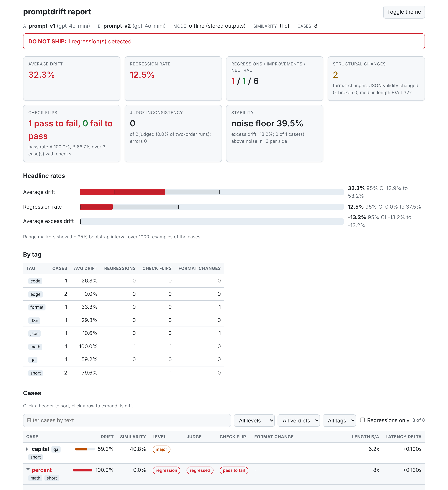
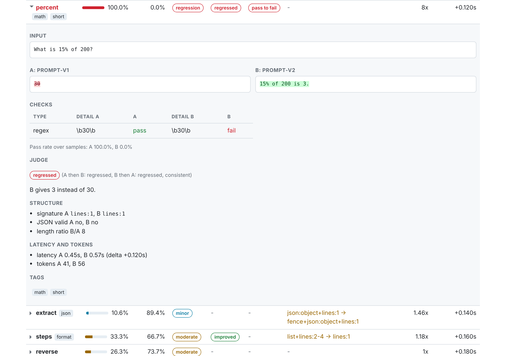
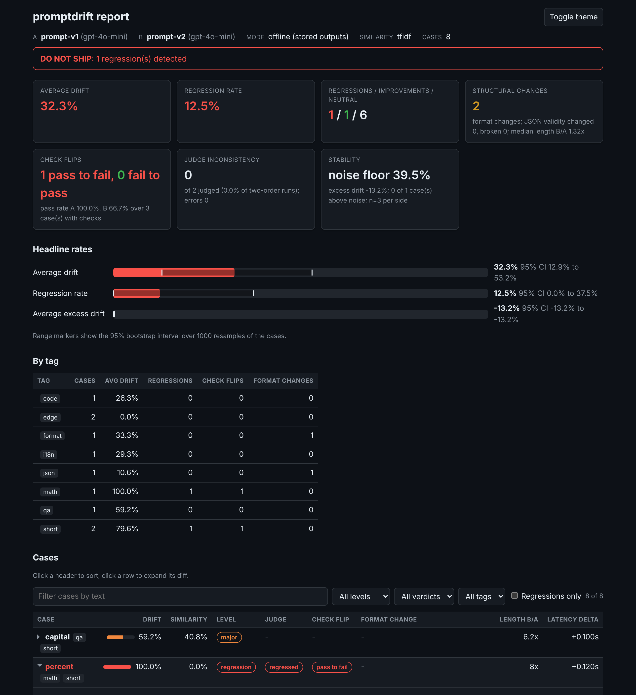
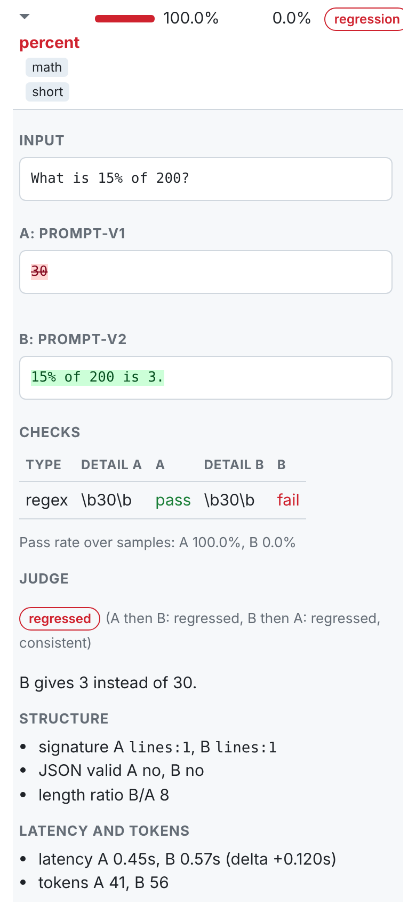

# Quickstart

Four steps, each building on the last. The first one needs no API key and
finishes in under two minutes.

## 1. Offline diff on logged outputs (zero keys)

Install from GitHub (promptdrift is not on PyPI yet) and clone the repository
for its example data:

```bash
git clone https://github.com/dakshtrehan/promptdrift
cd promptdrift
pip install -e .
```

Offline mode scores outputs you already have. The input is JSONL with one
record per case: a `case_id`, the output of the baseline (`output_a`) and the
output of the candidate (`output_b`). `examples/offline/outputs.jsonl` holds 16
logged replies of a support assistant before and after a prompt edit, with
tags and deterministic checks.

```bash
# docs-test: run
promptdrift diff examples/offline/outputs.jsonl --name-a v1 --name-b v2 --checks examples/offline/checks.yaml --summary
```

Output (header lines trimmed):

```text
  A  v1  (stored)
  B  v2  (stored)
  Cases: 16

  Summary
  ──────────────────────────────────────────────────────────────────────
  Avg drift         ████░░░░░░░░░░░░░░░░░░  17.9%  95% CI 7.8 to 30.4%
  Regression rate   ███░░░░░░░░░░░░░░░░░░░  12.5%  95% CI 0.0 to 31.2%

  ↑ Improved    1   ↓ Regressed   2   → Neutral    13

  Structure  format changed 3   JSON validity changed 1 (broken 1)   median length B/A 1.21x

  Checks     pass A 93.8%  B 87.5%  (16 cases)   pass→fail 2   fail→pass 1

  Stability  n=3/side   noise floor 70.6% (A 64.5%, B 76.6%)   excess drift -12.7%   above noise 0/1

  ──────────────────────────────────────────────────────────────────────
  ✗  DO NOT SHIP: 2 regression(s) detected
  ──────────────────────────────────────────────────────────────────────
```

Reading it:

- **Avg drift 17.9%**: on average the v2 reply shares most of its words with
  the v1 reply. The 95 percent interval is wide because 16 cases is few.
- **Regressed 2**: two cases went from passing a check to failing it. One is a
  refund window that silently changed from 30 to 14 days, the other a JSON
  reply that lost its closing brace. Drop `--summary` to see them listed.
- **Improved 1**: one case went from failing a check to passing it.
- **format changed 3**: three replies changed shape (prose became a list, JSON
  gained a code fence). Reported, not counted as regressions.
- **Stability**: one record carries three samples per side; its within-version
  drift (the noise floor, 70.6%) is larger than its cross-version drift, so the
  versions differ less than each one differs from itself.

Make it a CI gate with thresholds. Each breach prints one sentence to stderr
and the exit code becomes 1:

```bash
promptdrift diff examples/offline/outputs.jsonl --name-a v1 --name-b v2 --checks examples/offline/checks.yaml --summary --max-drift 0.10 --max-regressions 0 --max-flips 0
```

```text
  ✗ avg drift 17.9% exceeds max-drift 10.0%
  ✗ 2 regression(s) exceed max-regressions 0
  ✗ 2 check flip(s) from pass to fail exceed max-flips 0
```

Your own data only needs three fields per line. `input`, `expected`, `checks`
and `tags` are optional; see [Offline logs](recipes/offline-logs.md) for the
full format and how to export it from a pipeline.

```json
{"case_id": "capital", "input": "What is the capital of France?", "output_a": "Paris", "output_b": "The capital of France is Paris."}
{"case_id": "extract", "output_a": "{\"name\": \"Ada\"}", "output_b": "```json\n{\"name\": \"Ada\"}\n```", "checks": {"json_keys": ["name"]}}
```

The same thing in Python:

```python
from promptdrift import compare_outputs, print_report

report = compare_outputs("examples/offline/outputs.jsonl", version_a="v1", version_b="v2")
print_report(report)
print(report.avg_drift, [c.case_id for c in report.regressions])
```

## 2. Live compare with keys

Live mode runs two prompt configs against the same test cases, calling the
model for every case and version, then scores the outputs exactly as offline
mode does. `promptdrift init` scaffolds a starter project:

```bash
promptdrift init --dir ./prompts
```

```text
  ✓ Created in prompts/
    v1.yaml      baseline prompt config
    v2.yaml      new prompt config
    golden.json  test cases

  Next:
    export OPENAI_API_KEY=sk-...
    promptdrift compare prompts/v1.yaml prompts/v2.yaml --cases prompts/golden.json
```

A config is a flat YAML (or JSON) file:

```yaml
version: v2
provider: openai            # openai | anthropic | ollama
model: gpt-4o-mini
system: "You are a concise assistant."
prompt_template: "Please answer the following: {input}"
temperature: 0.0
max_tokens: 256
```

Install the provider SDK, export the key and run the comparison. This calls the
model and costs money: `2 x cases` generation calls, plus up to `2 x cases`
judge calls.

```bash
pip install -e ".[openai]"
export OPENAI_API_KEY=sk-...
promptdrift compare prompts/v1.yaml prompts/v2.yaml --cases prompts/golden.json
```

!!! tip "Keep the first run cheap"
    `--no-judge` halves the calls (similarity, structure and checks only).
    `--samples 3` triples the generation calls but adds a
    [noise floor](concepts/noise-floor.md), which is the only way to tell a
    real change from sampling noise.

The repository ships `examples/live/v1.yaml`, `v2.yaml` and `golden.json` for
this, plus `examples/live/mock_provider.py`, which drives the same `compare()`
code path with a scripted provider so every live-mode field (latency, tokens,
judge verdicts in both orders) can be seen without a key:

```bash
# docs-test: run
python examples/live/mock_provider.py
```

## 3. HTML, JUnit and CSV outputs

Every subcommand can write the report in several formats at once:

```bash
# docs-test: run
promptdrift diff examples/offline/outputs.jsonl --name-a v1 --name-b v2 --checks examples/offline/checks.yaml --summary --output report.json --html report.html --junit junit.xml --csv cases.csv
```

| Flag | File | Use it for |
|---|---|---|
| `--output FILE` | JSON (`report.to_dict()`) | Archiving, scripting, feeding `evaluate_thresholds()` later |
| `--html FILE` | One self-contained HTML page | Humans. Open from a CI artifact or an air-gapped laptop; no network requests |
| `--junit FILE` | JUnit XML, one testcase per case | CI test reporters (GitHub, Jenkins, GitLab) show regressions as failures natively |
| `--csv FILE` | One row per case | Spreadsheets, pandas, dashboards |

The HTML report has a verdict header, summary cards, confidence interval
bars, a per-tag breakdown and a case table that sorts, filters and expands
each row into a side-by-side word-level diff. Light and dark mode follow the
OS; the "Toggle theme" button remembers your choice. With JavaScript disabled
every diff is shown expanded.

<figure markdown>
  { loading=lazy }
  <figcaption>Light mode: verdict, summary cards, CI bars, per-tag breakdown and the case table.</figcaption>
</figure>

<figure markdown>
  { loading=lazy }
  <figcaption>An expanded case: deleted words are marked on A, inserted words on B.</figcaption>
</figure>

<div class="grid" markdown>

<figure markdown>
  { loading=lazy }
  <figcaption>Dark mode follows the OS and can be toggled.</figcaption>
</figure>

<figure markdown>
  { loading=lazy }
  <figcaption>Readable at phone width.</figcaption>
</figure>

</div>

!!! note
    The screenshots were built from `examples/outputs.jsonl` plus a few
    edge-case records; the "regressed" judge verdicts in them were set by hand
    so that no model was called.

In Python the same exports are one call each:

```python
from promptdrift import compare_outputs, save_html, save_csv, save_junit

report = compare_outputs("examples/offline/outputs.jsonl", version_a="v1", version_b="v2")
save_html(report, "report.html")
save_junit(report, "junit.xml")
save_csv(report, "cases.csv")
save_csv(report, "cases_full.csv", include_outputs=True)   # adds input, output_a, output_b
```

## 4. The GitHub Action

The repository root is a composite action, so `uses: dakshtrehan/promptdrift@main`
works. The minimal offline setup needs no key and calls no model:

```yaml
name: promptdrift

on:
  pull_request:

permissions:
  contents: read
  pull-requests: write   # only needed for the PR comment

jobs:
  drift:
    runs-on: ubuntu-latest
    steps:
      - uses: actions/checkout@v5
      - uses: dakshtrehan/promptdrift@main
        with:
          outputs: prompts/outputs.jsonl
          checks: prompts/checks.yaml
          max-drift: "0.15"
          max-flips: "0"
```

On every pull request the action runs `promptdrift diff`, posts or updates a
single summary comment (drift, check flips, format changes, confidence
intervals, a per-tag table and the regressed cases), writes the same Markdown
to the job summary, uploads `report.html`, `report.json`, `report.junit.xml`
and `report.csv` as an artifact, and fails the job when a threshold is
breached or (by default) when any case regressed.

See [CI gating](recipes/ci-gating.md) for live mode, fork pull requests and
JUnit reporters, and the [Action reference](reference/action.md) for every
input and output.

## Where next

- Assert no regressions inside an existing test suite: [pytest plugin](recipes/pytest.md).
- Re-run on every save while editing a prompt: [watch mode](recipes/watch.md).
- Understand the numbers before trusting them: [Concepts](concepts/drift.md).
